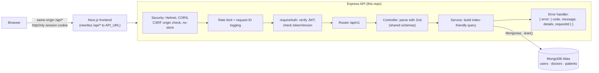
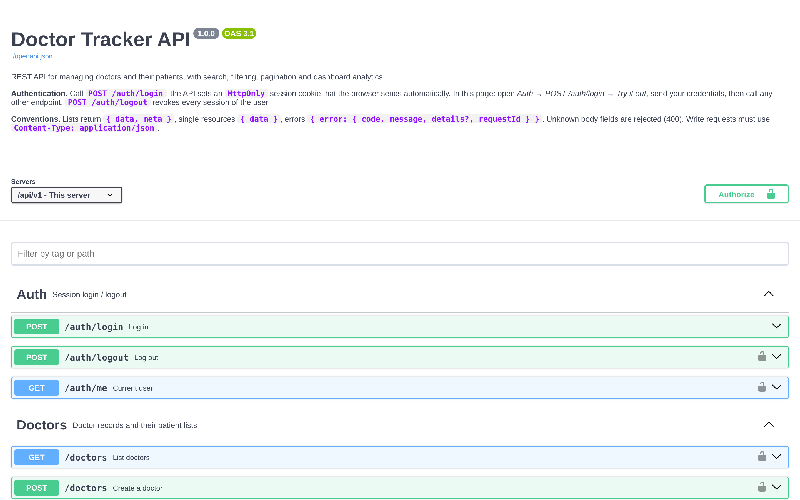

# Doctor Tracker: backend

**Doctor Tracker** is a secure admin portal for a hospital network: one place to see every doctor, the
patients each one looks after, and how admissions are trending, instead of scattered spreadsheets. This
repository is its **REST API**, a standalone Express 5 + MongoDB service. It authenticates administrators,
stores doctors and patients, answers fast searches and filtered, paginated lists over thousands of records,
and computes the dashboard statistics (patients per doctor, status and condition breakdowns, admissions over
time) with index-backed aggregations. Every input is validated against shared Zod schemas, and the API is
documented with OpenAPI 3.1 and covered by 43 automated tests. The web app that uses it lives in the
[frontend repository](https://github.com/Monjur14/Care_Guide-Doctor_Tracker_Frontend).

**Stack:** Node.js 22 · Express 5 · TypeScript · MongoDB + Mongoose 9 · Zod 4 · JWT in an `httpOnly`
cookie · Pino logging · Vitest + Supertest · OpenAPI 3.1 / Swagger UI

---

## Contents

1. [Setup guide](#setup-guide)
2. [System architecture](#system-architecture)
3. [Technical decisions](#technical-decisions)
4. [Visual evidence](#visual-evidence)
5. [Reference](#reference): scripts, project structure, API, security, query performance, testing, deployment

---

## Setup guide

### Prerequisites

- **Node.js 22.9 or newer** (`node -v`). The exact version is in [`.nvmrc`](.nvmrc).
- **A MongoDB database:** either MongoDB running locally (`mongodb://127.0.0.1:27017/doctor-tracker`) or a
  free [MongoDB Atlas](https://www.mongodb.com/atlas) cluster.

### Steps

1. **Clone and install**

   ```bash
   git clone https://github.com/Monjur14/Care_Guide-Doctor_Tracker_Backend.git
   cd Care_Guide-Doctor_Tracker_Backend
   npm install
   ```

2. **Create your environment file** from the template ([`.env.example`](.env.example)):

   ```bash
   cp .env.example .env
   ```

   Then edit `.env`. At minimum set `MONGODB_URI`, `JWT_SECRET` and the two `SEED_ADMIN_*` values. Generate a
   secret with:

   ```bash
   node -e "console.log(require('crypto').randomBytes(48).toString('base64url'))"
   ```

   | Variable | Default | Purpose |
   |---|---|---|
   | `MONGODB_URI` | *(required)* | `mongodb://` or `mongodb+srv://` connection string |
   | `JWT_SECRET` | *(required)* | Signs session tokens. At least 32 characters |
   | `SEED_ADMIN_EMAIL` / `SEED_ADMIN_PASSWORD` | | The admin account `npm run seed` creates. Password needs 12+ characters |
   | `CORS_ORIGINS` | `http://localhost:3000` | Comma-separated frontend origins (CORS and the CSRF origin check) |
   | `NODE_ENV` | `development` | `production` enables secure cookies and stricter checks |
   | `PORT` | `4000` | HTTP port |
   | `SESSION_TTL_MINUTES` | `480` | Session lifetime (5 to 1440) |
   | `TRUST_PROXY` | `1` | Proxies in front of the API (1 on Vercel), so rate limits see the real client IP |
   | `BCRYPT_ROUNDS` | `12` | Password hashing cost (10 or more in production) |
   | `LOG_LEVEL` | `info` | Pino log level |
   | `API_DOCS_ENABLED` | on, off in production | Set `true` to publish Swagger UI in production |

   Every variable is validated at startup. A missing or invalid value stops the server with a message that
   names the variable (never its value).

3. **Seed the database** with the admin user and demo data (40 doctors, 800 patients):

   ```bash
   npm run seed
   ```

   Running it again only updates the admin; `npm run seed -- --reset` regenerates the demo data.

4. **Start the API**

   ```bash
   npm run dev
   ```

5. **Check it works**

   ```bash
   curl http://localhost:4000/api/health          # {"status":"ok"}
   ```

   Open **http://localhost:4000/api/docs**, then **Auth → POST /auth/login → Try it out** with your seed
   admin. Every other endpoint can now be called from the browser.

6. **Run the tests** (no database needed; an in-memory MongoDB is started automatically):

   ```bash
   npm test
   ```

> **Troubleshooting:** if your network blocks DNS SRV lookups, `mongodb+srv://` fails with `querySrv
> ECONNREFUSED`. Use the standard `mongodb://host1,host2,host3/<db>?replicaSet=...&tls=true` string from
> Atlas → Connect → Drivers instead.

---

## System architecture



**Request lifecycle**

1. **Edge.** The frontend forwards `/api/*` requests to this API, so the browser's session cookie arrives as a
   first-party cookie. Helmet sets security headers, CORS allows only `CORS_ORIGINS`, and state-changing
   requests must carry an allowed `Origin` (CSRF).
2. **Throttling and tracing.** A per-IP rate limiter runs first; every request gets a request ID that appears
   in each log line and in any error response, so a user-reported error can be traced.
3. **Authentication.** `requireAuth` verifies the JWT (pinned HS256, issuer, audience, expiry), then checks
   the user's `tokenVersion` in MongoDB so logged-out tokens are rejected. `requireRole('admin')` guards
   every router except `/auth`.
4. **Validation.** Controllers parse params, query and body with the shared Zod schemas: unknown fields are
   rejected, types are coerced and bounded (page ≤ 1000, limit ≤ 100), and failures return `400` with
   per-field details.
5. **Services and data.** Services translate the validated input into queries shaped to hit a specific index,
   read with `.lean()` and projections, and return plain DTOs. Lists run the page query and the count in
   parallel.
6. **Errors.** One error handler converts Zod, Mongoose (cast, validation, duplicate key) and app errors into
   the same JSON shape, and never leaks stack traces or submitted values.

**Serverless.** On Vercel, `api/index.js` exports the bundled app as the function handler. The MongoDB
connection is cached on the module and opened lazily by the `ensureDb` middleware, so warm invocations reuse it.

**Shared contract.** `shared/` (local package `@doctor-tracker/shared`) holds the Zod schemas, enums and
response types. The frontend repo has an identical copy, so client forms and this API validate with the same
rules. The OpenAPI document is generated from the same schemas, so docs, validation and types can't drift.

---

## Technical decisions

### 1. Prefix search on a token index instead of `$text` or a case-insensitive regex

**The problem.** The doctor and patient lists need a single search box that matches names, emails, phone
numbers and hospitals as the user types ("smi" should find "John Smith"; "01711" should find "+880 1711 …"),
stay fast as the collections grow, and combine with filters, sorting and pagination.

**Options considered**

| Approach | Partial words as you type | Index use | Combines with filters + sort |
|---|---|---|---|
| `{ name: /smi/i }` regex on raw fields | Yes | **No**: unanchored, case-insensitive regex scans every document | Yes, but slowly |
| MongoDB `$text` index | **No**: matches whole stemmed words only | Yes | Limited: one text index per collection, relevance sort clashes with ours |
| Atlas Search (Lucene) | Yes | Yes | Yes, but needs an Atlas-only feature and a separate index pipeline |
| **Normalized tokens + anchored regex (chosen)** | Yes (word prefixes) | **Yes**: index bounds | Yes |

**Decision.** On every save, each document stores `searchTokens`: the lower-cased, accent-free words of its
searchable fields, plus phone digits in both international and local format. The field has a multikey index.
A query like `"joh smi"` becomes:

```js
{ searchTokens: { $all: [/^joh/, /^smi/] } }
```

An anchored, case-sensitive regex on a normalized field is turned by MongoDB into an index range scan
(`["joh", "joi")`), so search cost grows with the number of *matches*, not the collection size. Terms are
regex-escaped and capped at five, so user input can't inject regex syntax or cause catastrophic backtracking.

**Trade-off.** Tokens are extra data on every document and must be rebuilt when a searchable field changes
(a Mongoose `pre('validate')` hook does it on every create and update). Matches are by word prefix, not mid-word ("ith" won't find "Smith"), which
is how people search names anyway. `npm run db:explain` and `tests/indexes.test.ts` prove the plan uses
`IXSCAN`, never `COLLSCAN`.

### 2. Stateless JWT cookie with server-side revocation, instead of server sessions or bearer tokens

**The problem.** The API runs as serverless functions: many short-lived instances with no shared memory.
Admins still need a session that JavaScript can't steal, a logout that really ends the session (including on
other devices), and protection against password guessing.

**Options considered**

- **Server-side session store** (Redis or a Mongo `sessions` collection). Revocation is trivial, but every
  request needs a session lookup and an extra service to run or pay for.
- **Bearer JWT in `localStorage`.** Stateless, but readable by any XSS, and a token can't be revoked before it
  expires.
- **JWT in an `httpOnly` cookie + a per-user `tokenVersion` (chosen).**

**Decision**

- The token is an HS256 JWT (algorithm pinned, issuer, audience and expiry checked) in an `httpOnly`,
  `SameSite=Lax` cookie, named `__Host-dt_session` and `Secure` in production. JavaScript can never read it.
- Each user document has a `tokenVersion`, copied into the token. `requireAuth` compares them on every
  request (one indexed read by `_id`). **Logout increments the version**, instantly revoking every token
  issued before it, on every device. A rejected cookie is cleared in the response.
- Brute force is handled in two layers: a per-IP limiter (10 failed logins per 15 minutes) and a per-account
  lockout (5 failures lock the account for 15 minutes). The lockout lives in MongoDB, so it holds across all
  serverless instances, unlike an in-memory counter. Unknown email and wrong password return the same message.
- CSRF is blocked by `SameSite=Lax` plus an `Origin` allow-list on every state-changing request.

**Trade-off.** Revocation costs one small database read per request, which a pure stateless JWT avoids, and
revocation is per user rather than per device. For an admin tool that small cost buys a logout that actually
works and no extra infrastructure.

---

## Visual evidence

This repository has no UI of its own: its interface is the API, documented with Swagger UI at `/api/docs`.



Desktop and mobile screenshots of the application built on this API (sign-in, dashboard, doctors, doctor
detail, patients, forms) are in the
[frontend README](https://github.com/Monjur14/Care_Guide-Doctor_Tracker_Frontend#visual-evidence).


---

## Reference

### Scripts

| Command | What it does |
|---|---|
| `npm run dev` | Start with `tsx watch`, reading `.env` |
| `npm run build` / `npm start` | Bundle with tsup to `dist/`, then run it |
| `npm test` | Run the test suite (downloads a MongoDB binary on first run) |
| `npm run typecheck` | `tsc --noEmit` |
| `npm run seed` | Create or update the admin user, and add 40 doctors + 800 patients if the database is empty. `npm run seed -- --reset` regenerates them |
| `npm run db:indexes` | Sync the indexes declared in the models to the database |
| `npm run db:explain` | Print the query plan of every hot query (should show index scans, no `COLLSCAN`) |

### Project structure

```
.
├─ api/index.js        Vercel serverless entry (exports the bundled Express app)
├─ src/
│  ├─ app.ts           Express app: middleware order, routers, error handling
│  ├─ server.ts        Local entry: connects to MongoDB and listens
│  ├─ routes.ts        /api/v1 router; everything after /auth requires an admin session
│  ├─ config/          env validation, Mongo connection (cached across invocations), logger
│  ├─ middleware/      auth, security headers + CORS + CSRF, rate limits, request logging, errors
│  ├─ models/          User, Doctor, Patient schemas; each index commented with the query it serves
│  ├─ modules/         auth, doctors, patients, stats, meta. Each is routes → controller → service
│  ├─ docs/            OpenAPI document built from the Zod schemas + Swagger UI route
│  └─ utils/           search tokens, pagination helpers, AppError, serialization
├─ scripts/            seed, sync-indexes, explain (+ shared query definitions in lib/)
├─ shared/             @doctor-tracker/shared: Zod schemas, enums and API types (also in the frontend repo)
└─ tests/              Vitest suites; helpers create an admin and a logged-in agent
```

Request validation schemas, enums and response types live in [`shared/`](shared), installed as the local
package `@doctor-tracker/shared` (`"file:./shared"`). The frontend repo carries the same folder, so its forms
validate with exactly the same rules as the API. **When you change a schema, copy `shared/` to the other repo.**

### API overview

Base path: **`/api/v1`**. JSON in and out. Every route except `/auth/login` and `/api/health` needs an admin
session.

- **Lists** return `{ data, meta: { page, limit, total, totalPages } }`. `limit` defaults to 10, max 100.
- **Errors** return `{ error: { code, message, details?, requestId } }`. Validation errors list each failing
  field in `details`; duplicate emails return `409` with the field name.

| Method | Path | Notes |
|---|---|---|
| POST | `/auth/login` | `{ email, password }` → sets the session cookie |
| POST | `/auth/logout` | Revokes every session of the user |
| GET | `/auth/me` | Current user |
| GET | `/doctors` | `page, limit, search, specialization, hospital, from, to, sort=createdAt\|name, order` |
| POST | `/doctors` | `{ name, specialization, hospital, phone, email }` |
| GET / PATCH | `/doctors/:id` | Includes `patientCount` |
| GET | `/doctors/:id/patients` | Same filters as `/patients` |
| POST | `/doctors/:id/patients` | Add a patient under this doctor |
| DELETE | `/doctors/:id/patients/:patientId` | Remove a patient from this doctor's list |
| GET | `/patients` | `page, limit, search, condition, status, gender, doctorId, minAge, maxAge, from, to, sort=admissionDate\|createdAt\|name\|age, order` |
| GET / PATCH / DELETE | `/patients/:id` | PATCH accepts `doctorId` to reassign the patient |
| GET | `/stats/overview` | Totals, counts by status and condition, last 30 days |
| GET | `/stats/patients-per-doctor` | Top `limit` doctors by patient count |
| GET | `/stats/timeline` | `from, to, interval=day\|month, tz` (IANA zone); empty buckets filled with 0 |
| GET | `/meta/filters` | Dropdown options: specializations, conditions, statuses, genders, hospitals |
| GET | `/api/health` | Public liveness check |
| GET | `/api/docs`, `/api/openapi.json` | Swagger UI and the raw OpenAPI spec |

Example:

```bash
curl -c /tmp/dt-cookies.txt -H 'Content-Type: application/json' \
  -d '{"email":"admin@doctortracker.dev","password":"<your SEED_ADMIN_PASSWORD>"}' \
  http://localhost:4000/api/v1/auth/login

curl -b /tmp/dt-cookies.txt 'http://localhost:4000/api/v1/patients?status=admitted&condition=Diabetes&limit=5'
```

### Authentication and security

- **Session:** an HS256 JWT (algorithm pinned, issuer and audience checked) in an `httpOnly`, `SameSite=Lax`
  cookie (`__Host-dt_session` and `Secure` in production). JavaScript can't read it.
- **Revocation:** each user has a `tokenVersion`. Logout increments it, which invalidates every outstanding
  token. A rejected cookie is also cleared, so the frontend's redirect gate can't loop.
- **Brute force:** login is rate limited per IP (10 failures per 15 min) and the account locks for 15 minutes
  after 5 failed attempts. The lockout is stored in MongoDB, so it holds across serverless instances. Unknown
  email and wrong password return the same message.
- **CSRF:** state-changing requests must come from an allowed `Origin`, on top of `SameSite` cookies.
- **Input:** strict Zod schemas reject unknown fields, the `simple` query parser blocks `?a[$ne]=` operator
  injection, and JSON bodies are capped at 10 kB.
- **Other:** Helmet security headers, `Cache-Control: no-store` on API responses, a general limit of 600
  requests per 15 minutes per IP, and request IDs on every log line and error.

Full mapping to the OWASP Top 10:2025: [SECURITY.md](SECURITY.md).

### Query performance

- **Every list query uses an index.** Compound indexes end with `_id` to match the stable sort, so MongoDB
  reads results in index order instead of sorting in memory. `npm run db:explain` prints each plan, and
  `tests/indexes.test.ts` fails if any hot query falls back to a collection scan.
- **Search** stores normalized word tokens in a multikey `searchTokens` index and queries them with
  anchored prefix regexes. It is case and accent insensitive, matches any word ("smi" finds "John Smith")
  and uses index bounds rather than scanning names.
- **Pagination** runs the page query and the count in parallel; unfiltered totals use
  `estimatedDocumentCount` (collection metadata, no scan).
- **No N+1 queries:** patient counts for a page of doctors come from one `$group`, and doctor names on a page
  of patients from one `populate` (`$in`) query.
- **Dashboard:** status and condition counts are parallel index-only count scans; patients per doctor groups
  over a covered index and joins only the top N doctors; the timeline is a range scan on `admissionDate`
  grouped in the viewer's time zone.

### Testing and CI

`npm test` starts an in-memory MongoDB (`mongodb-memory-server`) for each run, so no database setup is needed. Each run starts an in-memory MongoDB (`mongodb-memory-server`), so no database setup is needed. Suites cover
auth and session security, doctors, patients, stats, index usage, and an OpenAPI contract test that checks
real responses against the documented schemas.

GitHub Actions (`.github/workflows/ci.yml`) runs type checking, the tests, a production build and `npm audit`
on every push and pull request. Dependabot opens weekly dependency update PRs.

### Deployment (Vercel)

Import this repo as a Vercel project (no root directory change needed). `vercel.json` builds with tsup and
rewrites every path to the serverless function in `api/index.js`.

1. Set the environment variables from the [setup guide](#setup-guide) in the Vercel project (`NODE_ENV=production`,
   `CORS_ORIGINS=https://<your-frontend-domain>`, `TRUST_PROXY=1`).
2. In MongoDB Atlas, allow connections from Vercel (Network Access).
3. Run `npm run seed` once against the production database from your machine.
4. Set the frontend's `API_URL` to this deployment's URL.

The Mongo connection is cached on the module, so warm invocations reuse it, and the `ensureDb` middleware
connects lazily on cold starts.
